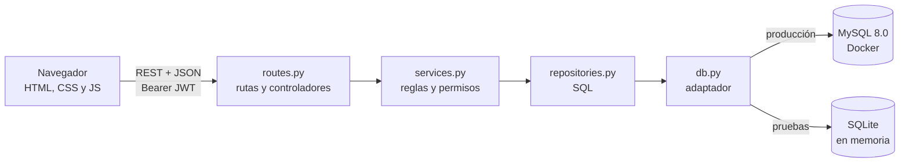
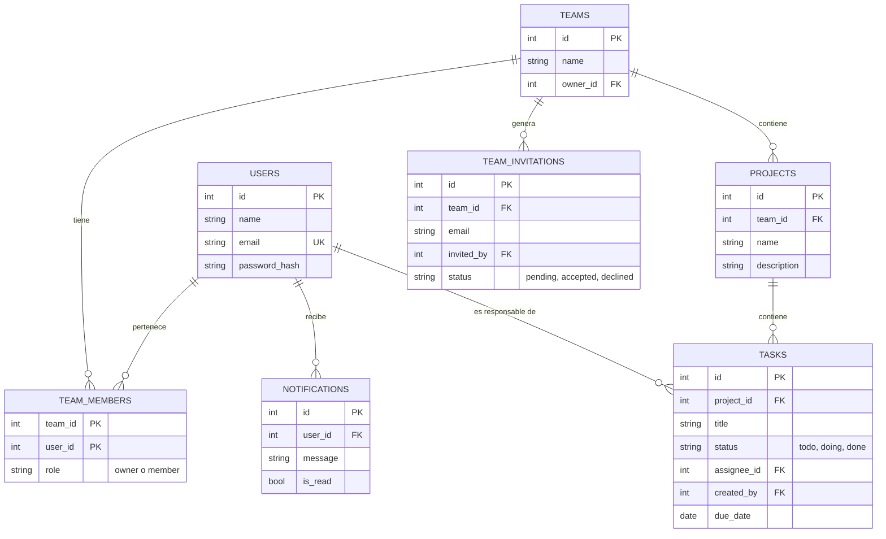
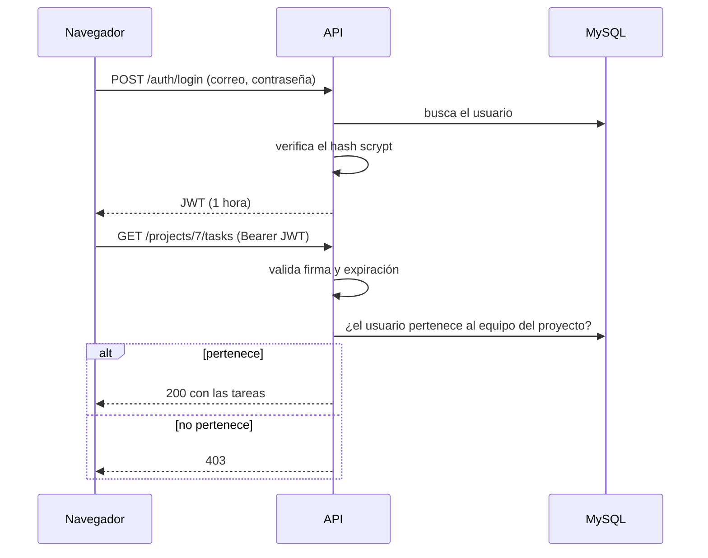

# Arquitectura

Resumen visual de las decisiones de [`adr/`](adr/README.md).

## Componentes

Cada capa solo habla con la siguiente (ADR 0004). El navegador consulta las
notificaciones cada 30 segundos (ADR 0006).

## Modelo de datos

Las claves foráneas, las restricciones `CHECK` y las transacciones mantienen la
integridad de los datos (ADR 0002).

## Inicio de sesión y acceso a un recurso

